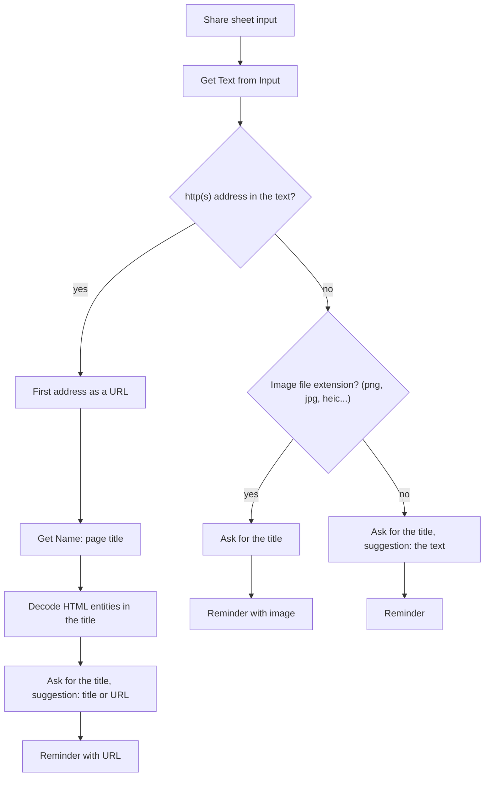

# Share to Reminders

An iOS share-sheet shortcut: share a **link, photo or text** and it adds a reminder
for today with an alert. The shortcut is generated from Python and tested end-to-end
on a Mac with the `shortcuts` CLI, without clicking through the Shortcuts editor.

The shortcut itself is called **"Na dziś"** (Polish for "for today"), and the code
and comments are in Polish; everything else should be readable from this page.

## What it does

| You share | Title suggestion | In the reminder |
|---|---|---|
| a link (Chrome, Safari, any app) | the page title, or the URL if the page does not respond | the URL in the URL field |
| a photo or screenshot | empty | the attached image |
| text | the shared text | title only |

Every time, the shortcut asks for the title with a suggestion you confirm with one tap.
The reminder goes to the **Urgent** list with an alert set to now.

Links win over images. Chrome on iOS shares a link together with a screenshot of the
page, so a shortcut that looks for images first saves the screenshot and loses the URL.

## Install

1. Download [`Na dziś.shortcut`](https://github.com/odwrotnie/share-to-reminders/raw/main/Na%20dzi%C5%9B.shortcut)
   and open it on an iPhone or a Mac, then tap "Add Shortcut".
2. Reminders needs a list called **Urgent**. For another list, change `LISTA`
   in [`skroty.py`](skroty.py) and build the shortcut yourself.
3. Share something and pick "Na dziś" in the share sheet.

Building it yourself (macOS with Shortcuts and iCloud signed in, since Apple signs it):

```bash
python3 skroty.py          # Na dziś.shortcut
```

## How it works



The generator ([`skroty.py`](skroty.py)) builds the plist from a few helpers: `tekst()`
makes a text parameter with variables, `Skrot.jezeli_ma_wartosc()` an If/Otherwise block,
`dodaj_przypomnienie()` the Add New Reminder action. Parameter keys come from the action
definitions shipped with macOS (the dyld shared cache), not from guesswork.

## Shortcuts pitfalls behind this design

All confirmed by tests on macOS 26 / Shortcuts 7.0:

- **"Get URLs from Input" returns nothing**, even for the text `https://example.com/`.
  So the address comes from a regular expression over the input text.
- **"Get Images from Input" turns text into an image.** A shortcut that asks "are there
  images?" sends every text down the image path. Images are detected by file extension.
- **Coercing text without an address, or an image, to URL stops the shortcut with an
  error** instead of returning nothing. Only the one address already found is coerced.
- **"Get Name" with the web page title option returns raw HTML** (`&amp;`). "Make Rich
  Text from HTML" returns nothing; saving the title as `tytul.html` and reading it with
  "Get Text from Input" decodes it. A page without `<title>` gives the end of the path.
- **The iPhone reads an HTML file without a charset as Windows-1252** ("szybkości"
  instead of "szybkości"), while the Mac reads it as UTF-8, so Mac tests do not catch it.
  Hence `<meta charset="utf-8">` before the title.
- **"Match Text" takes its input from the `text` key**, not `WFInput`.
- **A list of several addresses in the URL field gives an empty URL**, so it always uses
  the first one.

The full list, including environment quirks, is in [`CLAUDE.md`](CLAUDE.md) (Polish).

## Tests

`python3 skroty.py --test` builds a test version with the same logic as the real one
and three differences:

- instead of asking, it takes the title suggestion,
- instead of a reminder, it returns JSON with what it would save,
- after every action it appends a step to a trace that goes into the report
  (`na-dzis-testy/<time>.json` in iCloud Drive/Shortcuts). This also works when run on
  an iPhone, so you can see on the Mac what, say, Chrome really sent.

[`testy.py`](testy.py) serves local test pages and runs the shortcut with `shortcuts run`
for these scenarios: text, link, link without a title, dead link, link inside a sentence,
link followed by a full stop, link + screenshot (as from Chrome), link + title +
screenshot, image, a real page from the internet.

```bash
python3 skroty.py --test                   # build, then import in Shortcuts
python3 testy.py                           # all scenarios
python3 skroty.py --test --przypomnienia   # real reminders (titles start with TEST)
python3 testy.py tekst obraz               # selected ones; also checks list and alert
```

`testy.py` knows which version was built (with reminders or not) from
`wersja-testowa.json`. The test version is called `TEST Na dziś vN`: an import can add a
copy ("... 1") instead of replacing the shortcut, and the number only goes up when the
content changes (action UUIDs are deterministic, so the same source gives a byte-identical
file).

Importing cannot be done from the command line: `open file.shortcut` and click "Add Shortcut".

## License

[MIT](LICENSE)
