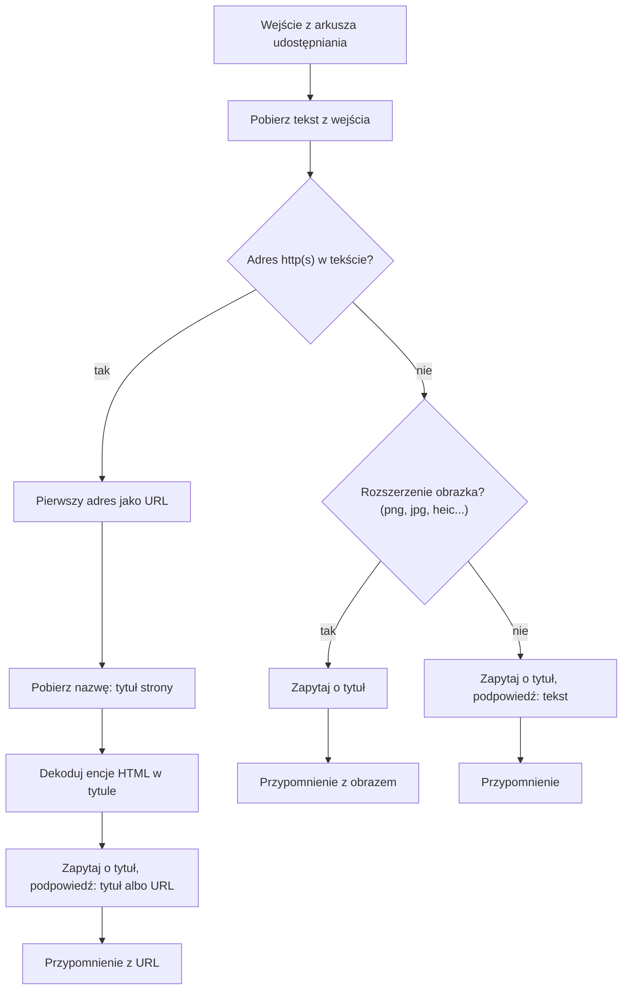

# Na dziś

Skrót iOS do arkusza udostępniania: udostępniasz **link, zdjęcie albo tekst**, a on
dodaje przypomnienie „na dziś” z alertem. Skrót jest generowany w Pythonie
i testowany end-to-end na Macu przez `shortcuts run`, bez klikania w edytorze Skrótów.

*An iOS share-sheet shortcut that turns a link, photo or text into a reminder for today.
Generated from Python and tested end-to-end with the macOS `shortcuts` CLI.*

## Co robi

| Udostępniasz | Podpowiedź tytułu | W przypomnieniu |
|---|---|---|
| link (Chrome, Safari, dowolna aplikacja) | tytuł strony, a gdy strona nie odpowiada, sam URL | URL w polu URL |
| zdjęcie, zrzut ekranu | puste pole | dołączony obraz |
| tekst | udostępniony tekst | tylko tytuł |

Za każdym razem skrót pyta o tytuł, z podpowiedzią do zatwierdzenia jednym „OK”.
Przypomnienie trafia na listę **Urgent** z alertem na bieżącą chwilę.

Link ma pierwszeństwo przed obrazem. Chrome na iOS udostępnia link razem ze zrzutem
strony, więc skrót, który najpierw szuka obrazów, zapisuje zrzut i gubi URL.

## Instalacja

1. Pobierz [`Na dziś.shortcut`](https://github.com/odwrotnie/na-dzis/raw/main/Na%20dzi%C5%9B.shortcut)
   i otwórz go na iPhonie albo Macu, potem „Dodaj skrót”.
2. W Przypomnieniach musi istnieć lista **Urgent**. Inna nazwa: zmień `LISTA`
   w [`skroty.py`](skroty.py) i zbuduj skrót sam.
3. Udostępnij coś i wybierz „Na dziś” w arkuszu udostępniania.

Budowanie samemu (macOS ze Skrótami i zalogowanym iCloud, bo podpis idzie przez Apple):

```bash
python3 skroty.py          # Na dziś.shortcut
```

## Jak to działa



Generator ([`skroty.py`](skroty.py)) składa plist z kilku pomocników: `tekst()` buduje parametr tekstowy ze zmiennymi, `Skrot.jezeli_ma_wartosc()`
blok Jeżeli/W przeciwnym razie, `dodaj_przypomnienie()` akcję przypomnienia. Nazwy
kluczy parametrów pochodzą z definicji akcji zaszytych w systemie (dyld shared cache),
a nie z domysłów.

## Pułapki Skrótów, które to wymusiły

Wszystko sprawdzone w testach na macOS 26 / Skróty 7.0:

- **„Pobierz URL-e z wejścia” nie zwraca nic**, nawet dla tekstu `https://example.com/`.
  Dlatego adres wyciąga wyrażenie regularne z tekstu wejścia.
- **„Pobierz obrazy z wejścia” robi obrazek z tekstu.** Skrót, który pyta „czy są
  obrazy?”, wysyła każdy tekst ścieżką obrazu. Obraz rozpoznajemy po rozszerzeniu pliku.
- **Wymuszenie typu URL na tekście bez adresu albo obrazku przerywa skrót błędem**,
  zamiast zwrócić pustkę. Typ URL dostaje tylko jeden, już znaleziony adres.
- **„Pobierz nazwę” z opcją tytułu strony daje surowy HTML** (`&amp;`). „Utwórz tekst
  sformatowany z HTML” zwraca pusto; dekoduje zapisanie tytułu jako `tytul.html`
  i odczyt „Pobierz tekst”. Strona bez `<title>` daje końcówkę adresu.
- **Plik HTML bez deklaracji kodowania iPhone czyta jako Windows-1252** („szybkoÅ›ci”
  zamiast „szybkości”), a Mac jako UTF-8, więc testy na Macu tego nie łapią. Stąd
  `<meta charset="utf-8">` przed tytułem.
- **„Dopasuj tekst” bierze wejście z klucza `text`**, nie `WFInput`.
- **Lista kilku adresów wstawiona w pole URL daje pusty URL**, stąd zawsze pierwszy adres.

Pełna lista, razem z drobiazgami środowiska, jest w [`CLAUDE.md`](CLAUDE.md).

## Testy

`python3 skroty.py --test` buduje wersję testową, która ma tę samą logikę co docelowa
i różni się trzema rzeczami:

- zamiast pytać, bierze podpowiedź tytułu,
- zamiast przypomnienia zwraca JSON z tym, co by zapisała,
- po każdej akcji dopisuje krok do śladu `na-dzis-testy/<czas>.txt` w iCloud Drive/Skróty,
  więc przy błędzie widać, na którym kroku stanęło. Działa też przy uruchomieniu z iPhone'a.

[`testy.py`](testy.py) stawia lokalny serwer ze stronami testowymi i uruchamia skrót
przez `shortcuts run` dla scenariuszy: tekst, link, link bez tytułu, martwy link,
link w zdaniu, link z kropką na końcu, link + zrzut (jak z Chrome), link + tytuł + zrzut,
obraz, prawdziwa strona z internetu.

```bash
python3 skroty.py --test                   # zbuduj, zaimportuj w Skrótach
python3 testy.py                           # wszystkie scenariusze
python3 skroty.py --test --przypomnienia   # prawdziwe przypomnienia (tytuły z TEST)
python3 testy.py tekst obraz               # wybrane; sprawdza też listę i alert
```

`testy.py` sam wie, którą wersję zbudowano (z przypomnieniami czy bez), bo czyta to
z `wersja-testowa.json`. Wersja testowa nazywa się `TEST Na dziś vN`. Import potrafi dodać kopię („… 1”) zamiast
zastąpić skrót, a numer rośnie tylko przy zmianie treści (UUID-y akcji są deterministyczne,
więc to samo źródło daje bajt w bajt ten sam plik).

Importu nie da się zrobić z wiersza poleceń: `open plik.shortcut` i kliknięcie
„Dodaj skrót”.

## Licencja

[MIT](LICENSE)
